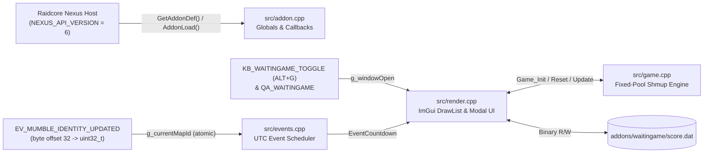

<p align="center">
  <a href="https://ko-fi.com/todd0042">
    
  </a>
</p>

---

# 🚀 Waitingame — Guild Wars 2 Nexus Shmup Addon

[-00d4ff.svg)](https://github.com/Todd0042/gw2-Waitingame/releases)
[-orange.svg)](https://github.com/RaidcoreGG/Nexus)
[](CMakeLists.txt)
[](mingw-toolchain.cmake)
[](https://ko-fi.com/todd0042)

> **A lightweight, map-aware arcade shoot-'em-up built into Guild Wars 2 via Raidcore Nexus so you can blast waves of enemies and laser-firing bosses while waiting for world bosses and meta events to spawn.**

<p align="center">
  
</p>

> [!NOTE]
> **AI Development Notice:** This addon includes AI-generated content and/or AI-assisted code. While efforts are made to review and validate all output, AI-generated components may contain errors, inconsistencies, or unintended behavior, and behavior may change as the addon evolves. The developer remains responsible for ensuring compliance with the Guild Wars 2 Terms of Service. If using AI-assisted software is a concern for you, please refrain from using or recommending it—and if you spot any bugs, please report them!

---

## 📖 Table of Contents

* **Part 1 — User Overview & Quick Start**
  * [🎮 What Is Waitingame?](#-what-is-waitingame)
  * [✨ Key Features](#-key-features)
  * [⏱️ How Event Detection & Gameplay Work](#️-how-event-detection--gameplay-work)
  * [🕹️ Controls & Keystroke Suppression](#️-controls--keystroke-suppression)
  * [🚀 Quick Installation & Build Instructions](#-quick-installation--build-instructions)
* **Part 2 — Technical Architecture & Reference**
  * [1. Addon Lifecycle, Nexus Integration & MumbleLink ([src/addon.cpp](src/addon.cpp))](#1-addon-lifecycle-nexus-integration--mumblelink)
  * [2. Shmup Game Loop, Enemy Waves & Boss State Machine ([src/game.h](src/game.h), [src/game.cpp](src/game.cpp))](#2-shmup-game-loop-enemy-waves--boss-state-machine)
  * [3. ImGui Rendering, HUD & High Score Persistence ([src/render.cpp](src/render.cpp))](#3-imgui-rendering-hud--high-score-persistence)
  * [4. GW2 World Boss & Meta Event Scheduler ([src/events.h](src/events.h), [src/events.cpp](src/events.cpp))](#4-gw2-world-boss--meta-event-scheduler)
  * [5. Build Configuration, Toolchain & Icon Pipeline ([CMakeLists.txt](CMakeLists.txt), [build.sh](build.sh), [gen_icon.py](gen_icon.py))](#5-build-configuration-toolchain--icon-pipeline)
  * [6. Repository Structure](#6-repository-structure)
  * [7. Verification & Diagnostics](#7-verification--diagnostics)
  * [8. Licensing, Third-Party Dependencies & Support](#8-licensing-third-party-dependencies--support)

---

# Part 1 — User Overview & Quick Start

## 🎮 What Is Waitingame?

**Waitingame** is a compact, self-contained vertical shoot-'em-up (SHMUP) overlay written for **Guild Wars 2** using the **Raidcore Nexus** addon framework. Instead of alt-tabbing or staring at a static spawn timer while camping a world boss or meta event, press `Alt+G` (or click the Quick-Access icon) to launch an arcade space shooter right inside your game window—complete with a live countdown to your map's next event.

---

## ✨ Key Features

* **🗺️ Map-Aware Event Countdowns**: Reads your live Guild Wars 2 `MapID` from MumbleLink via Nexus (`EV_MUMBLE_IDENTITY_UPDATED`). When you are on a tracked world boss or meta map, it counts down to that map's next event; when you are in a major city or untracked map, it displays the soonest upcoming event across all tracked schedules.
* **⚠️ 1-Minute Pre-Event Warning & Auto-Close**: When a tracked event on your current map is ~60 seconds away, Waitingame pauses the action and pops up a warning (`Keep Playing` or `Stop Now`). When the event starts (`00:00`), it saves your high score, shows a 3-second *"Time for \<Event\>! Good luck, Commander!"* banner, and closes automatically so you never miss the pull.
* **👾 Escalating Waves & Two Laser-Firing Bosses**: Battle 4 distinct enemy types (**Drones**, **Weavers**, **Gunners**, **Rushers**) with ramping spawn rates and speed multipliers, plus 2 recurring **Boss encounters** at `60s` and `180s` of every 4-minute cycle featuring single and triple sweeping laser beams.
* **💣 Screen-Clearing Bombs & Invincibility Frames**: Start each run with **3 lives** and **2 bombs** (`Caps Lock`) that wipe all active enemies and enemy projectiles off the canvas while awarding their points.
* **🔒 Zero Keystroke Leakage Box**: Includes a dedicated read-only suppression text box at the bottom of the window—click inside it to trap keyboard input inside the addon so arrow keys, `Shift`, `Space`, and `Caps Lock` don't trigger in-game GW2 skills or movement.
* **🏆 Persistent Local High Score**: Automatically saves and loads your personal best score to `<GW2>/addons/waitingame/score.dat`.

---

## ⏱️ How Event Detection & Gameplay Work

1. **Open the Overlay**: Press `Alt+G` (configurable in Nexus Input Binds) or click the **Waitingame** icon on the Nexus Quick-Access bar.
2. **Check the Countdown**:
   * **On a tracked boss/meta map** (e.g., Queensdale, Sparkfly Fen, Tangled Depths, Dragon's End): The HUD and menu lock onto the next event for your current map.
   * **In a city or untracked map** (e.g., Lion's Arch, Divinity's Reach, or maps without a mapped ID): Falls back to the next upcoming event across the entire UTC event table.
3. **Play While You Wait**: Press `Enter` or `Space` to start. Survive escalating waves, clear emergencies with `Caps Lock` bombs, and watch the HUD timer (turns red inside the final 60 seconds).
4. **Respond to Event Alerts**:
   * At **≤ 60 seconds** (when on a map with a tracked event), a modal lets you choose **Keep Playing** or **Stop Now**.
   * At **0 seconds** on that event map, the game saves your high score and auto-closes after 3 seconds.

---

## 🕹️ Controls & Keystroke Suppression

Because Waitingame shares keyboard focus with Guild Wars 2, use the bottom bar (`"click here to suppress keystrokes in-game"`) to control where your keystrokes go:
* **Click inside the suppression box** to capture keyboard focus in Waitingame so your ship controls don't leak into Guild Wars 2.
* **Click outside the window** to release keyboard focus back to Guild Wars 2.

| Input | Action |
| :--- | :--- |
| **`Alt + G`** *(or Quick-Access Icon)* | Toggle the Waitingame overlay window (rebindable via `KB_WAITINGAME_TOGGLE` in Nexus) |
| **`Enter` / `Space`** | Start game from Menu / Restart after Game Over |
| **`↑` `↓` `←` `→` (Arrow Keys)** | Move ship (`200 px/s` within the `340×460` arena) |
| **`Shift`** *(Left/Right)* | Fire main weapon (hold for `0.12s` rapid fire) |
| **`Caps Lock`** | Detonate bomb (2 per run; clears all enemies & enemy bullets) |

---

## 🚀 Quick Installation & Build Instructions

### Installing Prebuilt `waitingame.dll` in Guild Wars 2
1. Ensure **[Raidcore Nexus](https://raidcore.gg/Nexus)** is installed in your Guild Wars 2 directory.
2. Download `waitingame.dll` (or build it from source below) and place it in your Guild Wars 2 `addons/` directory (or `GW2/addons/waitingame/waitingame.dll`).
3. Launch Guild Wars 2 and press **`Alt + G`** (or click the **Waitingame** button on the Nexus Quick-Access bar).

### Cross-Compiling from Linux (`mingw-w64` + CMake)
Waitingame cross-compiles cleanly from Linux to a standalone Windows x64 DLL with zero external runtime DLL dependencies.

**Prerequisites:**
```bash
# Arch / CachyOS
sudo pacman -S mingw-w64-gcc cmake python

# Debian / Ubuntu
sudo apt install mingw-w64 cmake python3
```

**Build via [`build.sh`](build.sh):**
```bash
git clone https://github.com/Todd0042/gw2-Waitingame.git
cd gw2-Waitingame
./build.sh
```

**Or invoke CMake directly:**
```bash
cmake -B build -DCMAKE_TOOLCHAIN_FILE=mingw-toolchain.cmake -DCMAKE_BUILD_TYPE=Release
cmake --build build --config Release
```
The compiled addon is written to `build/waitingame.dll`.

---
---

# Part 2 — Technical Architecture & Reference

> *The sections below document every module, data flow, game-loop state machine, event schedule algorithm, and build setting verified directly from the source files.*

---

## 1. Addon Lifecycle, Nexus Integration & MumbleLink

[`src/addon.cpp`](src/addon.cpp) implements the Raidcore Nexus v6 DLL entry point and bridges GW2 runtime events into thread-safe globals consumed by the render loop.



### Exported Descriptor (`GetAddonDef`)
* **Signature**: `-556677`
* **API Version**: `NEXUS_API_VERSION` (`6`, defined in [`deps/nexus/Nexus.h`](deps/nexus/Nexus.h))
* **Name / Version**: `"Waitingame"` `{ 0, 1, 0, 0 }`
* **Auto-Update Metadata**: `UP_GitHub` pointing to `https://github.com/Todd0042/gw2-Waitingame`

### Startup & Shutdown Hooks (`AddonLoad` / `AddonUnload`)
* **Addon Directory**: Calls `APIDefs->Paths_GetAddonDirectory("waitingame")` into `g_addonDir` and ensures the directory exists via `CreateDirectoryA`.
* **Render Callback**: Registers `OnRender` on `RT_Render`. ImGui context/allocator initialization and high-score loading are deferred until the first frame inside `OnRender()`.
* **Input & Quick-Access**: Registers `KB_WAITINGAME_TOGGLE` (default `"ALT+G"`), creates `"ICON_WAITINGAME"` and `"ICON_WAITINGAME_HOVER"` from the embedded byte array in [`src/map_png.h`](src/map_png.h) via `Textures_GetOrCreateFromMemory`, and adds `"QA_WAITINGAME"` to the Nexus Quick-Access bar.
* **MumbleLink Map Tracking**: Subscribes `OnMumbleIdentityUpdated` to `"EV_MUMBLE_IDENTITY_UPDATED"`. Rather than depending on a full `Mumble::Identity` struct definition, it reads the 32-bit `MapID` directly at byte offset `32` (`Name[20] + Profession(4) + Specialization(4) + Race(4)`) and stores it in `std::atomic<uint32_t> g_currentMapId`.

---

## 2. Shmup Game Loop, Enemy Waves & Boss State Machine

The simulation core lives in [`src/game.h`](src/game.h) and [`src/game.cpp`](src/game.cpp) with fixed-size static object pools (zero per-frame heap allocations).

### Arena & Pool Constants ([`src/game.h`](src/game.h))
* **Playfield Canvas**: `CANVAS_W = 340.0f`, `CANVAS_H = 460.0f`
* **Outer Window**: `WIN_W = 356.0f` (`CANVAS_W + 16`), `WIN_H = 570.0f` (`CANVAS_H + HUD_H(45) + SUPPRESS_BAR_H(30) + 35`)
* **Fixed Pools**: `MAX_BULLETS = 256`, `MAX_ENEMIES = 96`, `MAX_PARTICLES = 192`, `NUM_STARS = 60`
* **Player Defaults**: `PLAYER_LIVES = 3`, `PLAYER_BOMBS = 2`, speed `200.0f px/s`, fire cooldown `0.12f s`, hit invincibility `2.0f s`, AABB half-extents `8.0f × 11.0f`

### Difficulty Curve & Enemy Roster ([`src/game.cpp`](src/game.cpp))
* **Spawn Interval**: `std::max(0.25f, 1.5f - g_game.elapsed * 0.0020f)` (ramps from `1.5s` down to `0.25s`)
* **Speed Multiplier (`sm`)**: `1.25f + g_game.elapsed * 0.002f`

| Type | Visual | Unlock Time | HP | Score | Hitbox (`HW × HH`) | Movement / Attack Pattern |
| :---: | :--- | :---: | :---: | :---: | :---: | :--- |
| **`0` Drone** | Red downward triangle | `0s` | `1` | `10` | `9 × 9` | Straight vertical descent (`80 * sm`) |
| **`1` Weaver** | Orange diamond | `> 45s` | `1` | `15` | `9 × 9` | Vertical descent (`65 * sm`) with horizontal sine weave (`amplitude = 55 px`) |
| **`2` Gunner** | Purple winged square | `> 90s` | `2` | `25` | `11 × 11` | Slow descent (`45 * sm`); fires aimed orange projectiles (`160 px/s`) every `1.5–3.0s` |
| **`3` Rusher** | Pink mini triangle | `> 150s` | `1` | `20` | `7 × 7` | Fast diagonal descent (`±75 * sm`, `125 * sm`), bouncing off arena side walls |
| **`4` Boss 1** | Yellow wide cruiser | `cycle 60s` | `40` | `200` | `34 × 20` | Enters to `10%` canvas height, then loops `MoveToPosition` → `Pause (3.0s)` → `FiringLaser (1.5s)` single wide beam |
| **`5` Boss 2** | Cyan wide cruiser | `cycle 180s` | `60` | `300` | `34 × 20` | Same state machine as Boss 1, firing a triple cyan laser spread (center + left/right angled quads) |

### Boss Progression Cycle
Every `240s` (`fmodf(g_game.elapsed, 240.0f)`), **Boss 1** spawns at `t = 60s` and **Boss 2** spawns at `t = 180s`. Spawning a boss clears normal enemies and enemy bullets, sets `g_game.bossActive = true` and `g_game.progressionPaused = true`, and freezes `elapsed` progression and standard spawns until the boss is defeated.

---

## 3. ImGui Rendering, HUD & High Score Persistence

[`src/render.cpp`](src/render.cpp) drives frame timing, input polling, ImGui draw-list rendering, event alerts, and binary high-score persistence.

* **First-Frame ImGui Binding (`OnRender`)**: Binds `ImGui::SetCurrentContext(APIDefs->ImguiContext)` and `ImGui::SetAllocatorFunctions(APIDefs->ImguiMalloc, APIDefs->ImguiFree, nullptr)`, calls `Game_Init()`, and invokes `LoadHighScore()`.
* **Delta-Time Clamping**: Measures frame delta via `std::chrono::steady_clock` clamped to `0.05f` seconds to avoid large simulation jumps during frame hitches.
* **Custom `ImDrawList` Canvas**: Clips to the `340×460` canvas region (`PushClipRect`), rendering the deep-space background (`IM_COL32(8, 8, 20, 255)`), parallax starfield, blinking player ship during invincibility, enemy geometry, boss laser rects/quads (with real-time laser-vs-player intersection checks in `DrawBossLasersAndDamage`), bullets, and fading particles.
* **HUD Header (`HUD_H = 45px`)**: Displays current `SCORE`, `BEST`, remaining life triangles, remaining bomb diamonds, and `<EventName> MM:SS` (yellow normally, red at `<= 60s`).
* **State Overlays & Modals**:
  * `GameState::Menu` (`DrawMenu`): Shows title, current/next event countdown + map name, key legend, and best score.
  * `GameState::GameOver` (`DrawGameOver`): Displays final score, `"NEW BEST!"` banner when beaten, and restart prompt.
  * `##wg_warn` Modal: Triggered once per run (`warningShown`) when `onEventMap && ec.secondsUntil <= 60`, pausing `Game_Update` until **Keep Playing** or **Stop Now** is clicked.
  * `GameState::EventClose` (`DrawEventClose`): Triggered when `onEventMap && ec.secondsUntil <= 0`; saves score and displays `"Time for <Event>!"` for `3.0s` before closing `g_windowOpen`.
* **High Score File (`score.dat`)**: `SaveHighScore()` and `LoadHighScore()` read/write a raw `int` to `<g_addonDir>\score.dat` on Game Over, Event Close, Stop Now, and window close (`X` button).

---

## 4. GW2 World Boss & Meta Event Scheduler

[`src/events.h`](src/events.h) and [`src/events.cpp`](src/events.cpp) compute UTC-based countdowns offline with zero network calls or API keys.

### Lookup Logic (`Events_GetForMap` & `Events_GetNextAny`)
1. On each render frame, `OnRender()` calls `Events_GetForMap(g_currentMapId)`.
2. If `s_events[]` contains one or more entries matching `mapId` (non-zero), it returns the soonest event on that map (`onEventMap = true`), enabling both the 1-minute warning modal and event-start auto-close.
3. If `mapId` is not matched (e.g., player is in a major city such as Lion's Arch `50`, Divinity's Reach `139`, Black Citadel `218`, Rata Sum `335`, The Grove `91`, Hoelbrak `179`, or an untracked zone), `OnRender()` falls back to `Events_GetNextAny()`, which returns the soonest upcoming event across all 49 entries in `s_events[]` without auto-closing when it starts.

### Scheduling Modes (`SecondsUntilNext`)
* **Uniform UTC Cycles (`intervalMinutes > 0`)**: Computes `posInCycle = ((s - offSec) % cycSec + cycSec) % cycSec` against UTC seconds since midnight (`gmtime_s` / `gmtime_r`). Returns `0` while `posInCycle < durationMinutes * 60`, otherwise returns `cycSec - posInCycle`. Supports 60-minute, 120-minute, and 180-minute cycles.
* **Irregular Daily Schedules (`intervalMinutes == 0`)**: Iterates explicit UTC minute arrays for **Tequatl the Sunless** (`00:00, 03:00, 07:00, 11:30, 16:00, 19:00`), **Triple Trouble** (`01:00, 04:00, 08:00, 12:30, 17:00, 20:00`), and **Karka Queen** (`02:00, 06:00, 10:30, 15:00, 18:00, 23:00`).

### Tracked Event Coverage (`s_events[]`)
* **Core World Bosses**: Svanir Shaman Chief (`28`), Fire Elemental (`35`), Great Jungle Wurm (`34`), Shadow Behemoth (`15`), Megadestroyer (`39`), The Shatterer (`20`), Modniir Ulgoth (`17`), Golem Mark II (`54`), Claw of Jormag (`30`), Tequatl the Sunless (`53`), Triple Trouble & Taidha Covington (`73`), Karka Queen (`873`).
* **Heart of Thorns**: Night Bosses (`1042`), Chak Gerent (`1045`), Octovine (`1043`), Dragon's Stand (`1041`).
* **Living World Season 3**: Lake Doric metas (Noran's Homestead, Saidra's Haven, New Loamhurst — `mapId = 0`, global countdown rotation).
* **Path of Fire & Living World Season 4**: Casino Blitz (`1210`), Buried Treasure (`0`), Path to Ascension & Doppelganger (`1228`), Junundu Rising & Maws of Torment (`1226`), Forged with Fire & Serpent's Ire (`1248`), Palawadan (`1263`), DB Shatterer (`1301`).
* **The Icebrood Saga**: Oil Floes & Thunderhead Keep (`1310`), Metal Concert (`1330`), Drakkar (`1343`), Twisted Marionette (`0`), Dragonstorm (`0`).
* **End of Dragons**: Kaineng Blackout (`1438`), Gang War & Aspenwood (`1452`), Dragon's End (`1422`), Aetherblade Assault (`1442`).
* **Secrets of the Obscure**: Defense of Amnytas (`1517`), Wizard's Tower (`1510`), Outer Nayos (`0`).
* **Janthir Wilds**: Of Mists and Monsters, A Titanic Voyage, Mount Balrior (`mapId = 0`, global countdown rotation).
* **Visions of Eternity**: Hammerhart Rumble!, Secrets of the Weald (`mapId = 0`, global countdown rotation).

*(Note: Events marked with `mapId = 0` participate in the global `Events_GetNextAny()` countdown but do not yet match a specific map for map-locked warnings/auto-close.)*

---

## 5. Build Configuration, Toolchain & Icon Pipeline

* **[`CMakeLists.txt`](CMakeLists.txt)**:
  * Targets C++17 (`CMAKE_CXX_STANDARD 17`) and builds `waitingame.dll` (`PREFIX ""`, `SUFFIX ".dll"`) from `src/addon.cpp`, `src/events.cpp`, `src/game.cpp`, `src/render.cpp`, and the vendored Dear ImGui v1.80 sources (`deps/nexus/imgui/imgui.cpp`, `imgui_draw.cpp`, `imgui_widgets.cpp`, `imgui_tables.cpp`).
  * Defines `WIN32_LEAN_AND_MEAN`, `NOMINMAX`, `UNICODE`, `_UNICODE`.
  * Statically links MinGW runtime libraries (`-static-libgcc`, `-static-libstdc++`, `-Wl,-Bstatic,--whole-archive -lwinpthread -Wl,--no-whole-archive,-Bdynamic`) so no extra MinGW DLLs are required on Windows.
* **[`mingw-toolchain.cmake`](mingw-toolchain.cmake)**: Configures CMake for `Windows` using `x86_64-w64-mingw32-gcc`, `x86_64-w64-mingw32-g++`, and `x86_64-w64-mingw32-windres` under `/usr/x86_64-w64-mingw32`.
* **[`build.sh`](build.sh)**: Convenience wrapper that configures `build/` in `Release` mode with `mingw-toolchain.cmake` and builds `build/waitingame.dll`.
* **[`gen_icon.py`](gen_icon.py)**: Standalone Python 3 utility that converts [`src/map.png`](src/map.png) into the C byte array header [`src/map_png.h`](src/map_png.h) (`map_png[]`, `map_png_len`) embedded directly into the DLL. Run `python3 gen_icon.py` after updating `src/map.png`.

---

## 6. Repository Structure

```text
gw2-Waitingame/
├── CMakeLists.txt           # C++17 shared library build & static MinGW linking config
├── build.sh                 # One-command Linux -> Windows x64 Release build script
├── mingw-toolchain.cmake    # x86_64-w64-mingw32 CMake cross-compilation toolchain
├── gen_icon.py              # Converts src/map.png into C byte array src/map_png.h
├── map.png                  # Source icon asset (root copy)
├── src/
│   ├── addon.cpp            # Nexus GetAddonDef, AddonLoad/Unload, keybind, Mumble MapID listener
│   ├── events.h             # EventCountdown struct & event lookup declarations
│   ├── events.cpp           # 49 GW2 world boss / meta event UTC schedules & city map list
│   ├── game.h               # Arena constants, entity structs, GameState & GameData definitions
│   ├── game.cpp             # Fixed-pool shmup physics, wave ramp, boss state machine & bombs
│   ├── render.cpp           # ImGui canvas renderer, HUD, suppression bar, warning modal & score.dat I/O
│   ├── map.png              # Source icon asset used by gen_icon.py
│   └── map_png.h            # Auto-generated embedded PNG byte array for Nexus Quick-Access icon
└── deps/
    └── nexus/
        ├── Nexus.h          # Raidcore Nexus API v6 C/C++ header (MIT License)
        └── imgui/           # Vendored Dear ImGui v1.80 sources & headers
```

---

## 7. Verification & Diagnostics

This repository does not include an automated unit/E2E test runner; verification is performed via clean cross-compilation, DLL import inspection, and in-game testing under Guild Wars 2 + Raidcore Nexus:

```bash
# 1. Clean Release cross-compile
./build.sh

# 2. Verify no external MinGW runtime DLL dependencies (only standard Windows DLLs should appear)
x86_64-w64-mingw32-objdump -p build/waitingame.dll | grep "DLL Name"

# 3. Regenerate embedded Quick-Access icon header if src/map.png changes
python3 gen_icon.py
```

---

## 8. Licensing, Third-Party Dependencies & Support

* **Repository License**: No top-level `LICENSE` file is currently included in this repository.
* **Third-Party Components**:
  * **Raidcore Nexus API** ([`deps/nexus/Nexus.h`](deps/nexus/Nexus.h)): Copyright (c) Raidcore.GG, licensed under the MIT License.
  * **Dear ImGui v1.80** ([`deps/nexus/imgui/LICENSE.txt`](deps/nexus/imgui/LICENSE.txt)): Licensed under the MIT License.
* **Guild Wars 2 Compliance**: Waitingame reads only the public MumbleLink `MapID` provided through Nexus, runs purely offline UTC math for event timers, and includes a read-only input-capture box to avoid keystroke leakage. Users remain responsible for ensuring compliance with the Guild Wars 2 Terms of Service.

---

<p align="center">
  If you enjoy blasting enemies between meta events with Waitingame, consider supporting open-source development:<br/><br/>
  <a href="https://ko-fi.com/todd0042" target="_blank">
    
  </a>
</p>

---

<p align="center">
  <a href="https://ko-fi.com/todd0042">
    
  </a>
</p>
